# EnviReader

[](https://doi.org/10.5281/zenodo.23327539)
[](LICENSE)
[](https://github.com/grazianoEnzoMarchesani/EnviReader/releases)
[](https://github.com/grazianoEnzoMarchesani/EnviReader/actions/workflows/pages.yml)

Read, explore and compare [ENVI-met](https://www.envi-met.com) simulation results in the browser. Open an output folder and EnviReader draws maps, sections, the 3D model, time series and the boundary conditions from the `EDX`/`EDT`, `INX`, `SIMX` and `FOX` files.

**Live app: [grazianoenzomarchesani.github.io/EnviReader](https://grazianoenzomarchesani.github.io/EnviReader/)** · [Releases](https://github.com/grazianoEnzoMarchesani/EnviReader/releases) · DOI [10.5281/zenodo.23327539](https://doi.org/10.5281/zenodo.23327539)

> **Your data never leaves your computer.** Files are read and processed in the browser. Nothing is uploaded to any server.

[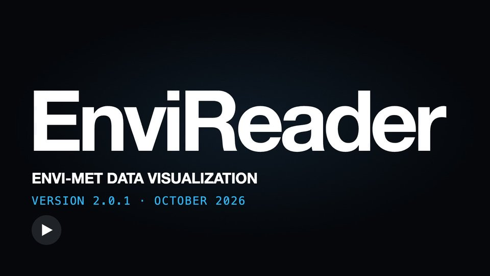](https://grazianoenzomarchesani.github.io/EnviReader/videos/EnviReader_trailer.mp4)

## Why EnviReader

An ENVI-met simulation produces a folder of binary files, one per output time, and looking at them takes software that not everyone who needs the results has installed. EnviReader opens that folder in a web page, with nothing to install and nothing sent anywhere, so the person who ran the simulation, a colleague reviewing it, a student or a designer comparing two scenarios can all look at the same data.

It is open source software, written at the School of Architecture and Design Eduardo Vittoria, University of Camerino, for research and teaching on urban microclimate. The aim is that a result can be checked, compared with another scenario and exported as a figure for a paper or a report.

## Getting started

1. Open the [live app](https://grazianoenzomarchesani.github.io/EnviReader/) in Chrome, Edge, Firefox or Safari.
2. Click **+ Open fileset A** and choose the output folder of a simulation, the one that contains `atmosphere/`, `biomet/`, `surface/` and so on.
3. To compare, click **+ Open fileset B (compare)** and choose a second output folder.

No ENVI-met results at hand? Download one scenario of the [Via Milano, Pescara dataset](https://doi.org/10.5281/zenodo.20022483) (CC BY 4.0, four runs of about 1.6 GB each), unzip it and open the folder inside as fileset A. Open a second scenario as fileset B to compare.

Whatever the browser dialog says, the files are read inside the page and are not sent anywhere.

[](https://grazianoenzomarchesani.github.io/EnviReader/videos/F01_opening-a-fileset.mp4)

## Features

The short silent clips below show some of the features at work, about 40 seconds each. Click an image to play its clip.

The app has four views, in the bar at the top: *2D Data Analysis*, *3D Data Analysis (beta)*, *WebGIS (alpha)* and *Boundary conditions*. The first three share the same sidebar (Data, Wind, Palette, Cursors, Presets) and the same state: time, level, sections, dataset, palette and wind settings stay as they are when you switch view.

### Files and data

- **Opening a fileset.** EnviReader scans the folder and its subfolders for `EDT`/`EDX` pairs, groups them by subfolder (`atmosphere`, `biomet/UTCI`, `surface`, …) and sorts them by the date and time in the file name. It also reads the model (`INX`), the simulation settings (`SIMX`) and the terrain. The button then shows the simulation name.
- **Data group and dataset.** The data group is the output subfolder; the dataset is the variable, read from the `EDX` header (*Potential Air Temperature (°C)*, *Wind Speed (m/s)*, *UTCI (°C)*, …). When you change group, the dataset stays selected if the new group has it.

[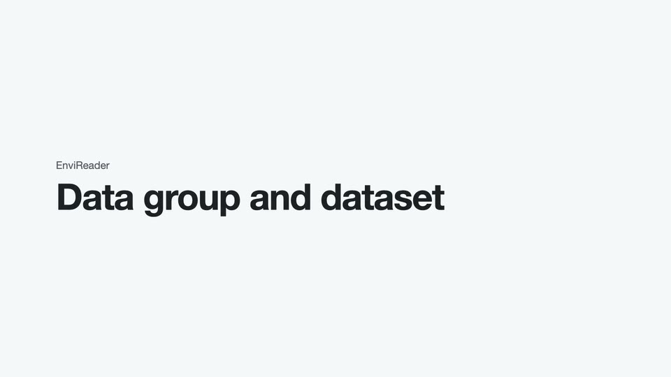](https://grazianoenzomarchesani.github.io/EnviReader/videos/F10_data-group-and-dataset.mp4)

- **Two simulations side by side.** Fileset B is optional. With B open the maps can show *Only A*, *Only B*, *A vs B* or *A vs B vs Diff*. The difference is computed cell by cell, on a scale symmetric around zero, with its own diverging palette and a choice between A − B and B − A. Click the button again to close B.

[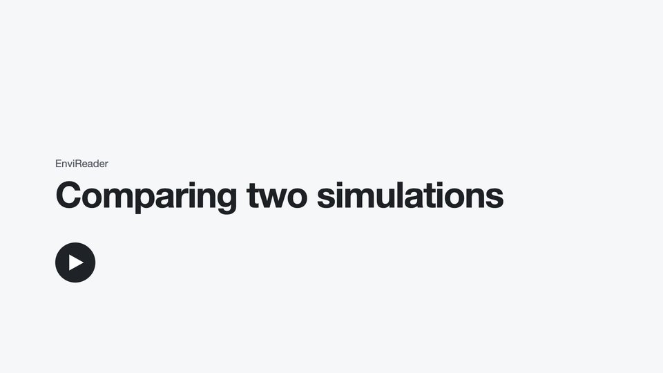](https://grazianoenzomarchesani.github.io/EnviReader/videos/F02_comparing-two-simulations.mp4)

[](https://grazianoenzomarchesani.github.io/EnviReader/videos/F20_compare-modes.mp4)

[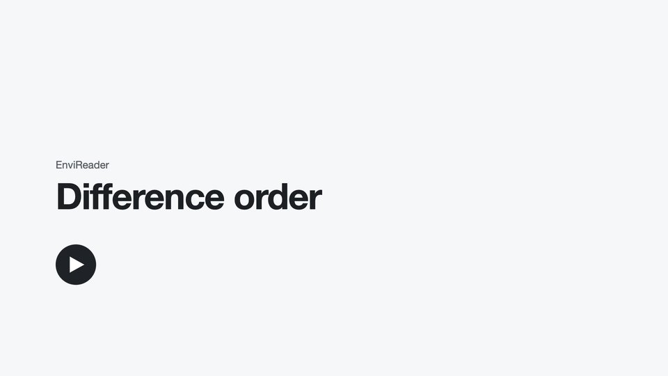](https://grazianoenzomarchesani.github.io/EnviReader/videos/F36_difference-order.mp4)

### 2D Data Analysis

#### Plan and sections

The large map shows the plan or one of the two vertical sections, longitudinal and transverse; the other two views sit below it as thumbnails, each with its own small legend. Click a thumbnail, or press `1`, `2`, `3`, to swap. Groups with a single level, such as `surface`, show the plan only.

[](https://grazianoenzomarchesani.github.io/EnviReader/videos/F21_plan-and-sections.mp4)

#### Crosshair and tooltip

The two sections cross at a point, the crosshair, which together with the level decides what the sections, the time series and the height readout show.

- Hover a cell to read its value.
- Click the plan to move the crosshair there; click a section to move the other section and the level.
- Near a section line in the plan a handle appears: drag it to rotate the sections. A chip with the angle brings them back to square.
- A, B and Diff follow the same crosshair.

[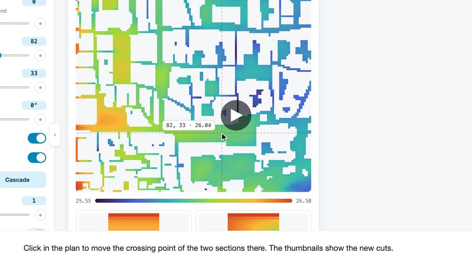](https://grazianoenzomarchesani.github.io/EnviReader/videos/F27_crosshair-and-tooltip.mp4)

#### View zoom

*View zoom*, from 1× to 3×, enlarges the maps up to one per row at full width.

[](https://grazianoenzomarchesani.github.io/EnviReader/videos/F22_view-zoom.mp4)

#### North, date and time on the map

Three switches put a north arrow, the day and the time of the current step on the map. The arrow follows the model rotation stored in the `INX`. They are indicators only.

[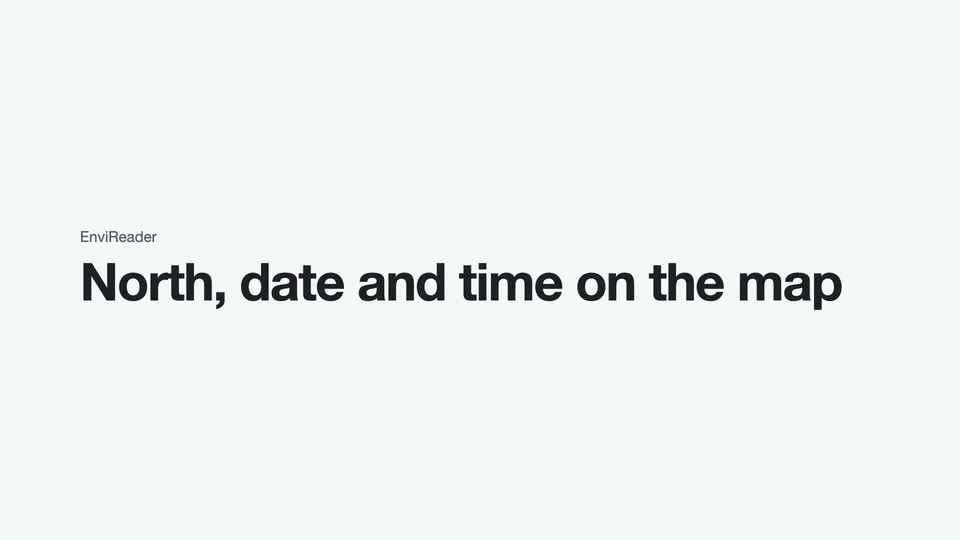](https://grazianoenzomarchesani.github.io/EnviReader/videos/F30_north-date-and-time.mp4)

#### Time slider

The *Time* slider picks the step shown in the maps. Each step is one output file, labelled with its date and time. Move with `−` / `+`, drag the slider, type a step number and press `Enter`, or use `←` / `→`. The maps, the thumbnails, the clock on the map and the time series follow.

[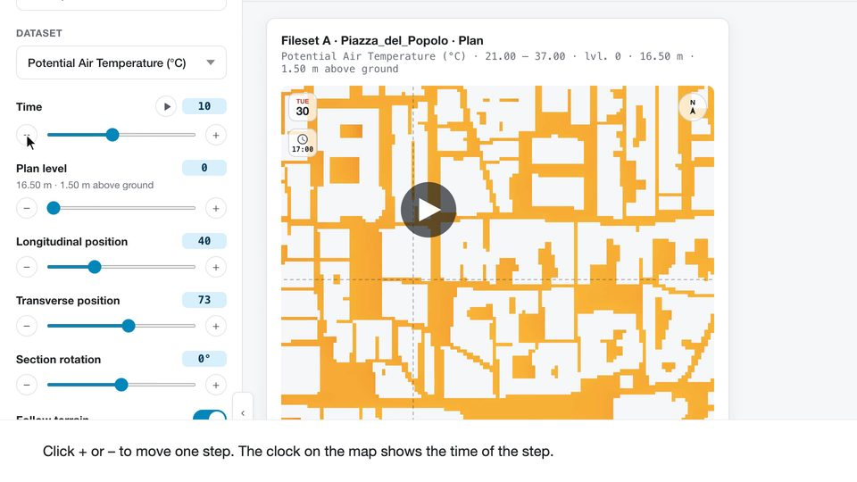](https://grazianoenzomarchesani.github.io/EnviReader/videos/F11_time-slider.mp4)

#### Time player

The ▶ button next to *Time* opens a small player: step back, play/pause, step forward, and speeds 1×, 5× and 10× (1× is one step every 0.6 s). After the last step it starts again from the first. Playback keeps going when the player is closed and when you change view, so the 3D model, the sun and the wind volume follow it too. Key `Space`.

[](https://grazianoenzomarchesani.github.io/EnviReader/videos/F12_time-player.mp4)

#### Time series at a point

The *Time series* panel below the maps plots the dataset over time at the crosshair. The header names the point and its height. A vertical line marks the step shown in the maps; over the chart, a tooltip gives date, time and value. Click the chart to jump to that step. Move the crosshair, in the plan or in a section, and the curve follows. With fileset B open, B is drawn as a dashed line, and each saved position adds a line of its own. Click the header to fold the panel.

[](https://grazianoenzomarchesani.github.io/EnviReader/videos/F40_time-series.mp4)

#### Levels, sections and terrain

- **Plan level** with the real height, in metres, at the crosshair. Keys `↑` / `↓`.

[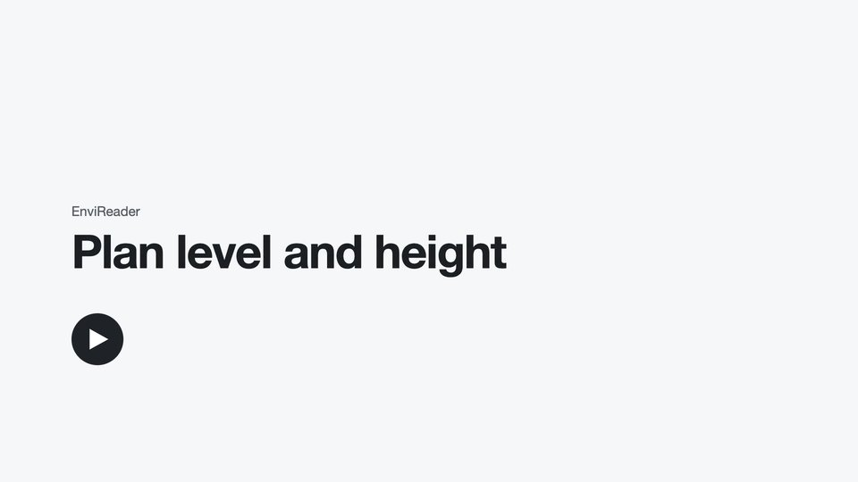](https://grazianoenzomarchesani.github.io/EnviReader/videos/F13_plan-level.mp4)

- **Section position** for the longitudinal and transverse sections, and **section rotation** from −90° to +90°: the sections become oblique vertical planes.

[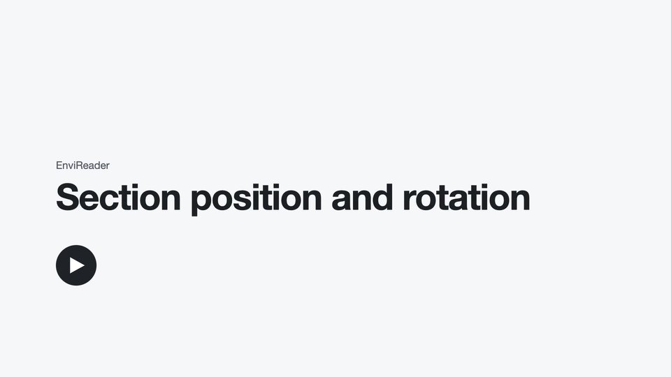](https://grazianoenzomarchesani.github.io/EnviReader/videos/F14-F15_section-position-rotation.mp4)

- **Follow terrain** (on by default): the plan drapes over the terrain, so the level counts from the ground. It affects the plan, the section profiles, the time series, the 3D overlay and the height readout.
- **Leveling mode.** As the level rises, the cut gradually stops following the terrain and becomes flat. *Standard* flattens the relief evenly; *Cascade* (default) keeps each column at its height until the level reaches it, like water filling the low areas first. *Transition height* sets over how many levels this happens.

[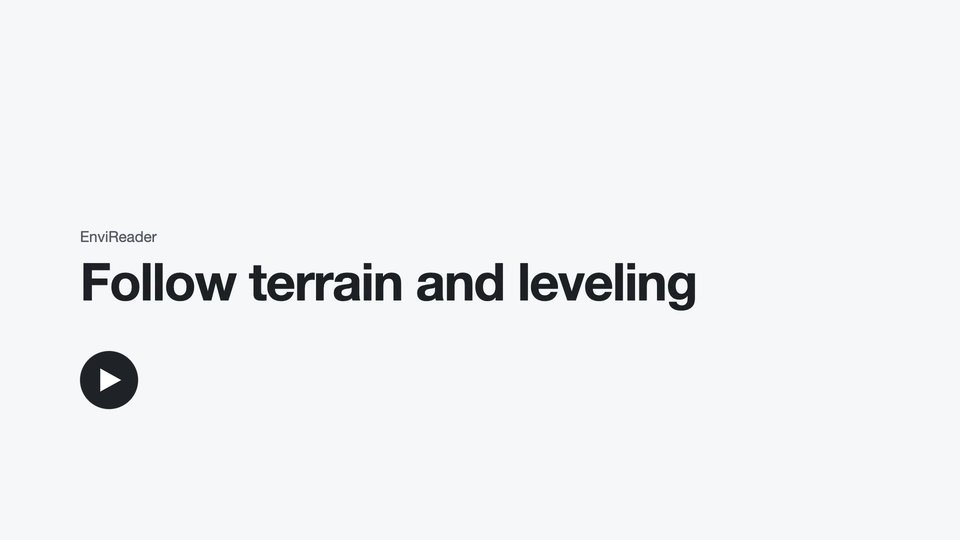](https://grazianoenzomarchesani.github.io/EnviReader/videos/F16-F17_follow-terrain-leveling.mp4)

- **Biomet section fix.** In biomet datasets (PMV, PET, SET, UTCI) ENVI-met exports each column pressed against the bottom of the domain. The fix puts the values back above buildings and terrain, in 2D, in 3D and in the time series.

[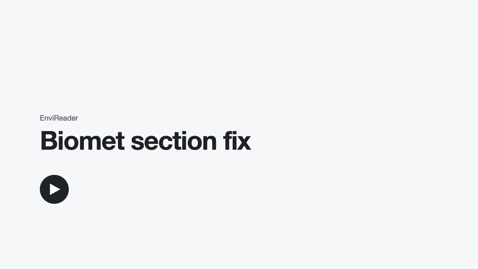](https://grazianoenzomarchesani.github.io/EnviReader/videos/F29_biomet-fix.mp4)

#### Color scale

*Legend bounds* sets the data the color scale is computed on:

| Option | Range taken from |
|---|---|
| *single chart* | each map on its own |
| *across views* (default) | each type of view (plan, longitudinal, transverse), shared by A and B |
| *fileset* | plan and sections of the same fileset together |
| *all filesets* | plan and sections of A and B together |
| *manual* | values you set |

Click a legend to set a manual range for that view, with a two-handle slider or Min/Max fields. The automatic ranges cover the current step only and are recomputed at every step; to compare different hours on the same colors, use a manual range.

[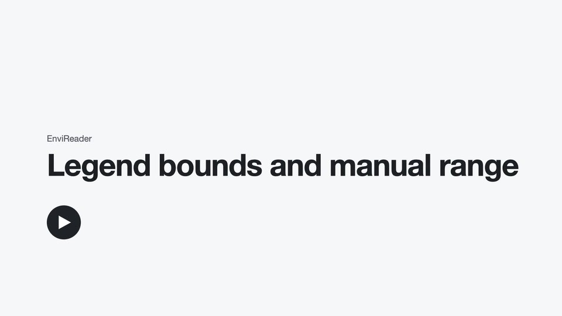](https://grazianoenzomarchesani.github.io/EnviReader/videos/F25-F26_legend-bounds.mp4)

#### Rendering and objects

- **Pixel**, one color per cell at the grid resolution; **Contour**, filled bands with isolines; **Vector (SVG)**, the grid drawn as vector shapes, heavier but ready for SVG export.
- **HD** resamples the map to the physical resolution of the screen.

[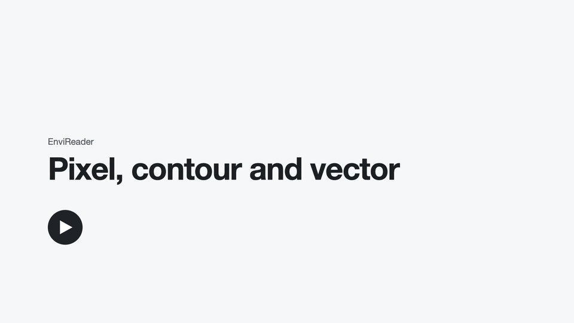](https://grazianoenzomarchesani.github.io/EnviReader/videos/F23-F24_pixel-contour-vector.mp4)

- **Objects overlay**: buildings, terrain and vegetation outlines over the data, with adjustable opacity.

[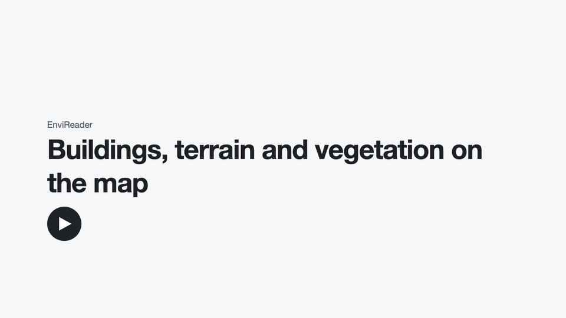](https://grazianoenzomarchesani.github.io/EnviReader/videos/F28_objects-on-map.mp4)

- **Object styles**, shared with 3D: *Default* (minimal voxels), *Style 1* (technical: thick outlines, 45° hatching, vegetation as circles sized by density), *Style 2* (white architectural model), *Style 3* (silhouette and outline).

[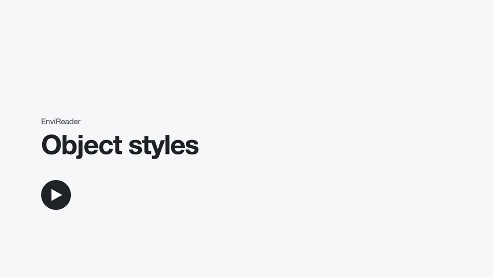](https://grazianoenzomarchesani.github.io/EnviReader/videos/F32_object-styles.mp4)

- **View settings**: section line thickness, dash and color; intermediate legend values; legend text size; widget size.

[](https://grazianoenzomarchesani.github.io/EnviReader/videos/F31_view-settings.mp4)

#### Zebra

Diagonal stripes, as on a camera exposure meter, mark the cells above a high percentile (black) and below a low percentile (blue, slanted the other way, so the two stay distinct without relying on color). *Inverted* greys out everything outside the chosen range instead. The slider shows the real value of each percentile, computed on the visible view.

[](https://grazianoenzomarchesani.github.io/EnviReader/videos/F18_zebra-overlay.mp4)

#### Wind

With the *Flow u/v/w* components (usually in `atmosphere`), the wind is drawn on the plan, on the sections and on the thumbnails as *Arrows*, *Streamlines* or *Combined*, with opacity, size and density from 0 to 100%. The reference value in the wind legend is the same for A, B and every view, so lengths can be compared anywhere. Key `F`.

[](https://grazianoenzomarchesani.github.io/EnviReader/videos/F33-F34_wind-field.mp4)

#### Palettes

- **Scientific**: Turbo, Viridis, Thermal, Coolwarm, Mono grey; RdBu, PiYG and Warm-Cool for differences.
- **Catalog**: the 62 palettes of EnviReader 1.x (C1–C62).

[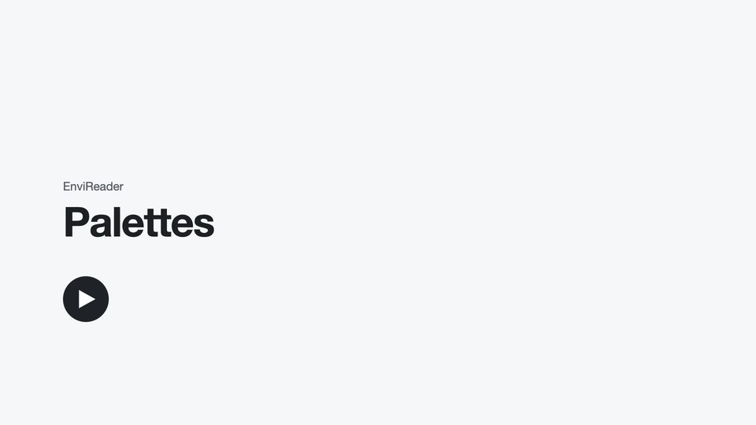](https://grazianoenzomarchesani.github.io/EnviReader/videos/F35_palettes.mp4)

- **My palettes**: an editor with 2 to 8 color stops and a live preview on the maps. Every palette can be reversed.

[](https://grazianoenzomarchesani.github.io/EnviReader/videos/F37_palette-editor.mp4)

- **Sharing**: import and export as JSON, or copy a text code (`EVR1:hex-hex-…:Name`) to send by chat or email.

[](https://grazianoenzomarchesani.github.io/EnviReader/videos/F38_sharing-palettes.mp4)

#### Saved positions

The *Cursors* tab saves the current crosshair (sections, angle, level, terrain settings) under a name and a color. Each saved position adds its own line to the time series, which is how you compare several points of the same model over time. Import and export as JSON.

[](https://grazianoenzomarchesani.github.io/EnviReader/videos/F39_saved-positions.mp4)

#### Presets

- **15 built-in presets**: air temperature, wind, relative humidity, mean radiant temperature and UTCI, each at 08:00, 14:00 and 20:00. The time is matched to the nearest step at that hour.

[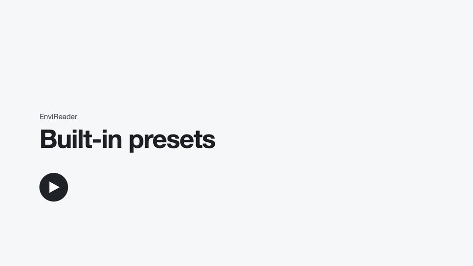](https://grazianoenzomarchesani.github.io/EnviReader/videos/F90_built-in-presets.mp4)

- **My presets**: save the current state under a name. A preset stores data group, dataset, time of day, level, sections, terrain settings, wind settings, legend bounds and palettes. It does not store render style, zebra, comparison mode, view type or 3D options.

[](https://grazianoenzomarchesani.github.io/EnviReader/videos/F91_own-presets.mp4)

- **Sharing**: exported presets carry the custom palettes they use; the `preset.json` of EnviReader 1.x can be imported too.

[](https://grazianoenzomarchesani.github.io/EnviReader/videos/F92_sharing-presets.mp4)

### 3D Data Analysis (beta)

- **Model viewer.** Buildings (2.5D or full 3D), voxel terrain, vegetation and receptors rebuilt from the `INX`, with grid size, resolution and maximum height. Needs a data group with more than one level.
- **Layers**: buildings `B`, vegetation `V`, terrain `T`, receptors `R`, and the domain walls with width, depth and height dimensions.

[](https://grazianoenzomarchesani.github.io/EnviReader/videos/F41-F42_the-3d-model.mp4)
- **Data overlay** (`O`): the current dataset as a plan and sections inside the model, with the 2D palette. *Smooth surface* (default) draws a continuous surface, off it draws one voxel per cell; the color stays the exact cell value. In *Contour* style the surface gets 3D isolines.

[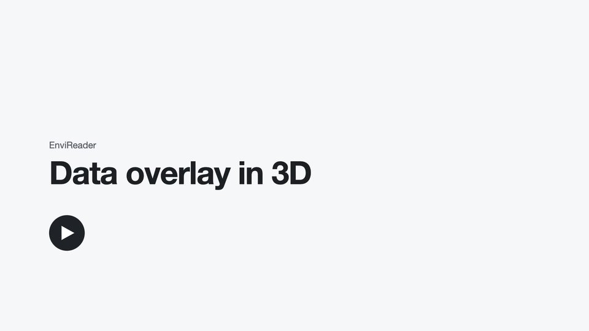](https://grazianoenzomarchesani.github.io/EnviReader/videos/F43_data-overlay-3d.mp4)

[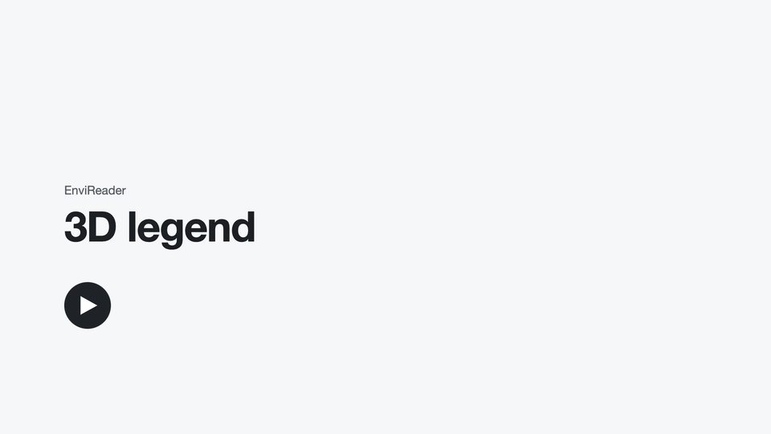](https://grazianoenzomarchesani.github.io/EnviReader/videos/F44_3d-legend.mp4)

[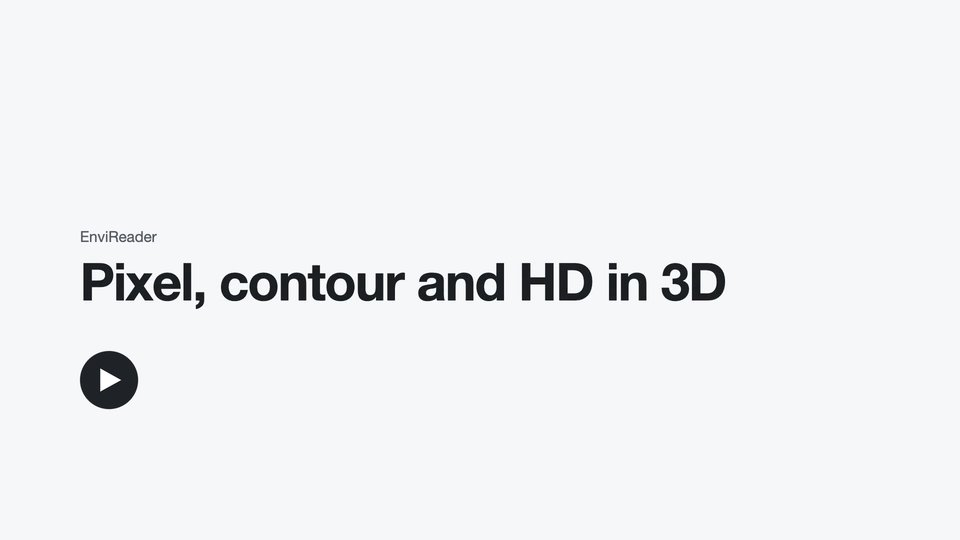](https://grazianoenzomarchesani.github.io/EnviReader/videos/F45_pixel-contour-hd-3d.mp4)

- **Interaction**: click the terrain to move the crosshair; drag near a section trace to rotate the sections; drag elsewhere to orbit.

[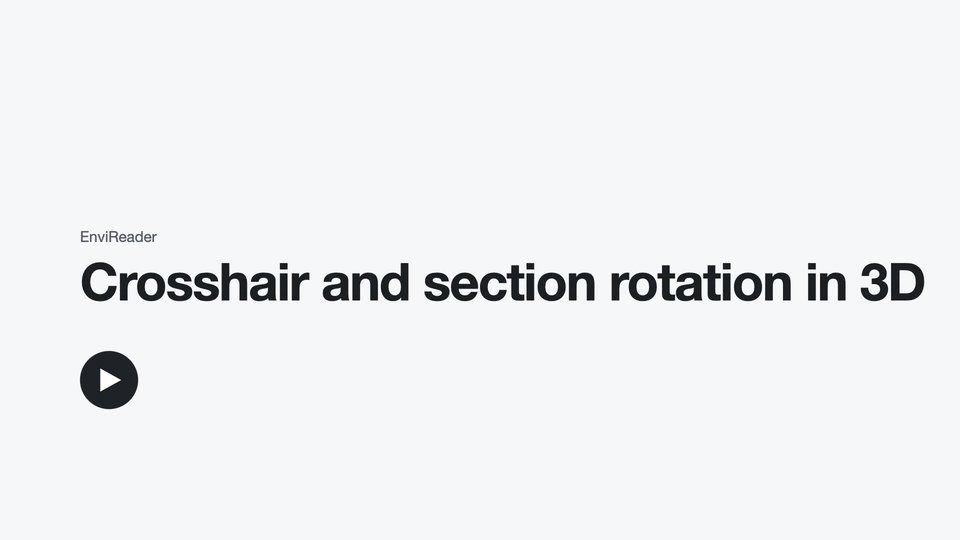](https://grazianoenzomarchesani.github.io/EnviReader/videos/F46_crosshair-rotation-3d.mp4)

- **ViewCube**: click a face, edge or corner to align the camera; Home and 90° rotation buttons. Keys `1` / `2` / `3` for top, right and front.

[](https://grazianoenzomarchesani.github.io/EnviReader/videos/F47_viewcube.mp4)
- **View settings**: wireframe, ambient occlusion, perspective or parallel projection, north reference (true north, or the grid of the model).

[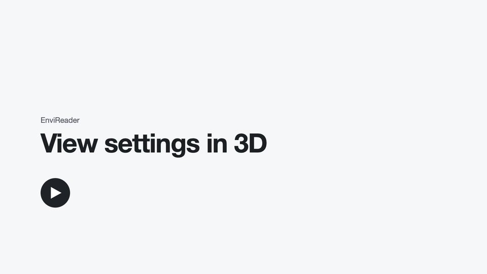](https://grazianoenzomarchesani.github.io/EnviReader/videos/F48_view-settings-3d.mp4)
- **A vs B**: two models side by side, with an option to link their cameras. There is no difference view in 3D.

[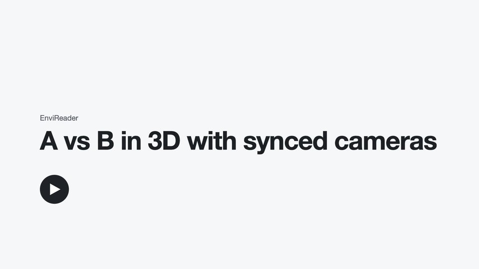](https://grazianoenzomarchesani.github.io/EnviReader/videos/F49_ab-3d-synced-cameras.mp4)

- **Sun and shadows** (`S`): sunlight and cast shadows for the date and time of the current step, with a sun path diagram (yearly month arcs and hourly analemmas, today's arc highlighted) and the sun's azimuth and altitude. The data colors are not shaded. Needs coordinates in the `INX`.

[](https://grazianoenzomarchesani.github.io/EnviReader/videos/F50_sun-and-shadows.mp4)

- **Wind in 3D**: on the data slices (`F`) or as a volume filling the whole domain (`Shift+F`), from the u, v, w components.

[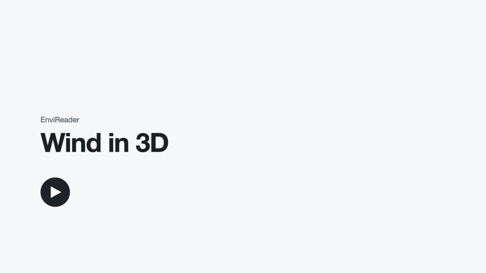](https://grazianoenzomarchesani.github.io/EnviReader/videos/F51_wind-3d.mp4)

- **Receptors**: click a receptor to open a chart for each variable in its output file, with a height selector when it has several levels.

[](https://grazianoenzomarchesani.github.io/EnviReader/videos/F52_receptors.mp4)

### WebGIS (alpha)

- The 3D model, with the same layers, object style and data overlay, placed at its real position on a map you can tilt and rotate. Uses fileset A only, and needs coordinates in the `INX`.
- **Georeferencing calibration**: east and north offset in metres, rotation, quick reference points. Saved per site in the browser.
- **Basemap**: an OpenFreeMap black and white street map, off until you accept it (see [Privacy](#privacy)). Without it the model sits on a plain background.

### Boundary conditions

- **Simulation settings** from the `SIMX`: name, model file, start and duration, wind and roughness, initial temperature and humidity, output folder, and which quantities are forced in a Full Forcing run.

[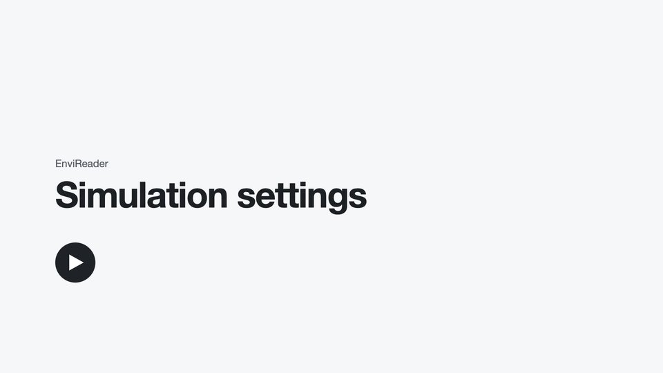](https://grazianoenzomarchesani.github.io/EnviReader/videos/F70_simulation-settings.mp4)

- **Simple Forcing**: hourly temperature and humidity charts.
- **Full Forcing** from the `FOX` file: site, coordinates, time zone and period, an overview chart, and one chart per quantity (temperature, humidity, wind, direct, diffuse and long-wave radiation, precipitation, pressure, cloud cover, background pollutants), up to three heights each. Yearly files of 8760 hours are drawn as a min–max envelope. If the `SIMX` names a `FOX` that is not in the folder, you can open it by hand.

[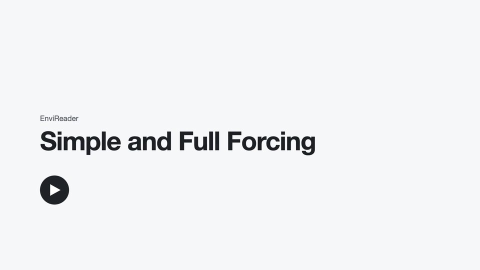](https://grazianoenzomarchesani.github.io/EnviReader/videos/F71-F72_full-forcing.mp4)

- **Period**: the simulation period, the whole file, a single month, or a range dragged on the overview chart.

[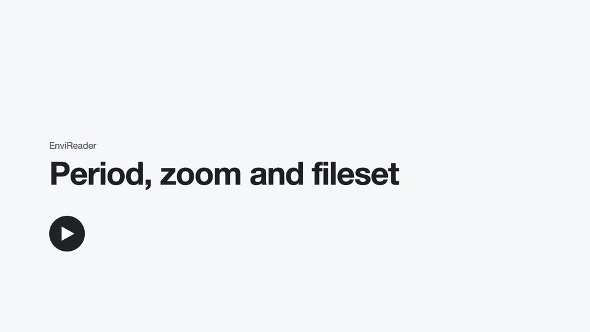](https://grazianoenzomarchesani.github.io/EnviReader/videos/F73-F74_period-zoom-fileset.mp4)

- Switch between the boundary conditions of A and B.

### Export

*Save charts* exports the chosen maps (A, B, A vs B, A vs B vs Diff) at the current step:

- PNG of plan and sections, 1200 px wide;
- hybrid SVG: raster map with vector text, legend, section lines and widgets, editable in Illustrator or Inkscape;
- SVG of the time series and of the boundary condition charts;
- an animated GIF over all steps, with adjustable frame rate;
- the numbers as CSV or Excel, one sheet per step when the GIF is included;
- all in one ZIP, with descriptive file names.

Export always runs from the 2D view, then restores view, time and comparison. Nothing is exported from 3D or WebGIS.

[](https://grazianoenzomarchesani.github.io/EnviReader/videos/F80a_exporting-images.mp4)

[](https://grazianoenzomarchesani.github.io/EnviReader/videos/F80b_gif-and-data.mp4)

### Interface

#### Theme and language

Light and dark theme (`Shift+D`), following the system on first launch; the 3D background, the 3D wind and the boundary charts follow it too. Five languages: English, Italiano, Deutsch, Español, Français.

[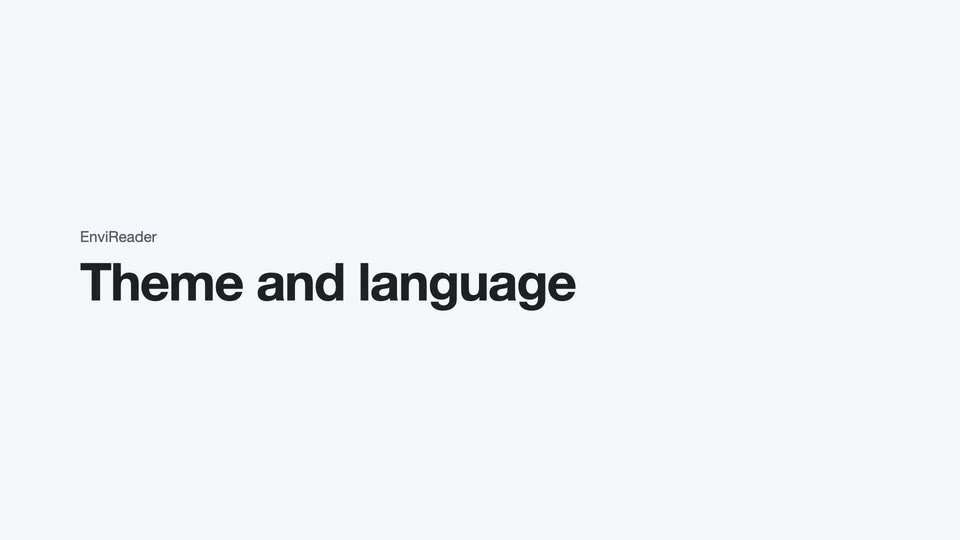](https://grazianoenzomarchesani.github.io/EnviReader/videos/F03-F04_theme-and-language.mp4)

#### Keyboard shortcuts

Press `Shift+?` for the list in the app. Shortcuts are ignored while typing in a field.

| Key | Action |
|---|---|
| `Space` | Play / pause |
| `←` `→` | Previous / next step |
| `↑` `↓` | Level up / down |
| `1` `2` `3` | 2D: plan, longitudinal, transverse section. 3D: top, right, front view |
| `B` `V` `T` `R` | Buildings, vegetation, terrain, receptors |
| `O` | Data overlay in 3D |
| `S` | Sun |
| `F` / `Shift+F` | Wind on the slices / 3D wind volume |
| `C` | Cycle comparison modes (with B open) |
| `A` | Switch between 2D and 3D |
| `G` / `E` | WebGIS / Boundary conditions |
| `\` | Hide or show toolbar and sidebar |
| `Shift+D` | Theme |
| `Shift+?` | Shortcut list |

The same list is in [docs/keyboard_shortcuts.txt](docs/keyboard_shortcuts.txt).

[](https://grazianoenzomarchesani.github.io/EnviReader/videos/F05_keyboard-shortcuts.mp4)

#### Privacy and credits

A first-run banner reminds you that the files stay in the browser. The *Privacy* panel has the full notice and a button that deletes everything the app has stored (palettes, presets, saved positions, calibrations, map consent). Click the EnviReader logo for version, authors and citation.

[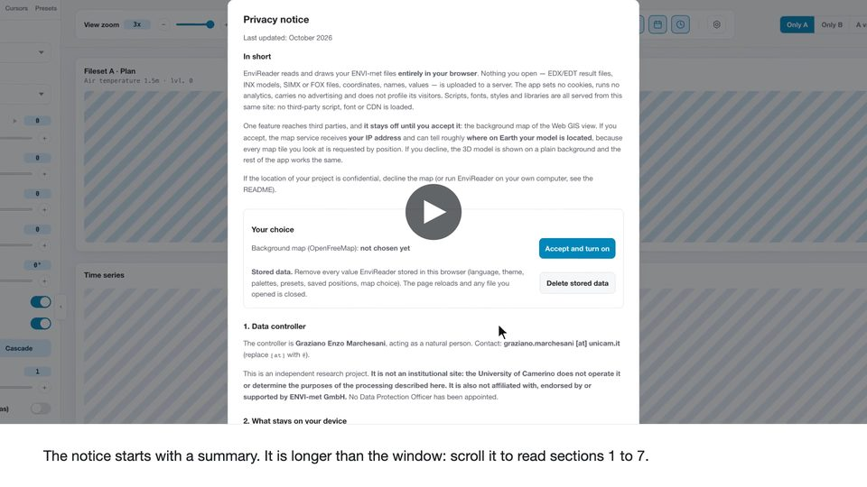](https://grazianoenzomarchesani.github.io/EnviReader/videos/F06-F07_privacy-and-credits.mp4)

## Technical notes

### Files it reads

| File | Used for |
|---|---|
| `EDX` / `EDT` | Results: the `EDX` is the XML header (grid, variables), the `EDT` the binary data. One pair per output time. |
| `INX` | Model: buildings, terrain, vegetation, receptors, location, model rotation. |
| `SIMX` | Simulation settings and Simple Forcing. |
| `FOX` | Full Forcing time series. |
| Receptor output | Time series at each receptor. |

- Result files are matched by name, `<name>_<TYPE>_<YYYY-MM-DD>[_<HH.MM.SS>].EDX`, with the time optional. Files without a date in the name, such as `_INXGRID` or the yearly solar access file, are skipped.
- `EDT` values are little-endian 32-bit floats, read through a typed-array view on the file buffer. ENVI-met's `-999` becomes "no data" and is drawn transparent.

### How it runs

- Everything happens in the browser. The build in `dist/` is static, uses relative paths, and runs from any folder of any web server.
- Folder access uses the File System Access API in Chrome and Edge, and a directory file input in Firefox and Safari. The result is the same; only the dialog differs.
- The 3D wind volume is computed in a Web Worker, so the page stays responsive. The map library's worker is bundled with the app rather than loaded from a CDN.
- 3D with three.js (WebGL), maps with MapLibre GL.
- Georeferencing uses the UTM coordinates of the `INX` (`realworldLowerLeft`) when present, otherwise its latitude and longitude.
- The sun position comes from the `INX` coordinates and the date and time of each step; the time zone is estimated from the longitude.
- Preferences, palettes, presets, saved positions, calibrations and map consent are kept in the browser's local storage, never on a server.

### Known limits

- The automatic legend ranges cover the current step only (see [Color scale](#color-scale)).
- 3D and WebGIS are marked beta and alpha. WebGIS shows fileset A only, without wind, sun, zebra or comparison.
- Export works from the 2D view only.

## Privacy

No cookies, no analytics, no third-party scripts, fonts or CDNs: everything the app needs is served from the same site. The only contact with third parties is the optional background map of the WebGIS view (OpenFreeMap street map), which stays **off until you accept it** because the map service sees your IP address and which area you are looking at. Consent lasts six months and can be withdrawn from the Privacy panel. The full notice is in the app (button *Privacy*) and in [src/data/privacyText.js](src/data/privacyText.js). `npm run audit:privacy` checks, on every deploy, that the code contacts no host and stores no key that the notice does not declare, and a Content-Security-Policy in `index.html` restricts the page itself to the same list.

## Run locally

```bash
npm install
npm run dev      # development server
npm run build    # production build in dist/
npm run lint
npm run audit:privacy   # after a build: hosts and storage keys vs. the privacy notice
```

Pushing to `main` deploys `dist/` to GitHub Pages (`.github/workflows/pages.yml`).

## Project layout

| Path | Contents |
|---|---|
| `src/components/` | UI: views, sidebar, charts, modals, controls |
| `src/lib/` | Parsers (`EDX`/`EDT`/`INX`/`FOX`), slicing, color maps, wind field, 3D scene, export |
| `src/state/` | Global application state |
| `src/data/` | Constants, palettes, presets, privacy notice |
| `src/i18n/`, `public/translations.json` | Translations |
| `scripts/` | Privacy audit |

Built with React, Vite, three.js and MapLibre GL.

## History

EnviReader started as *ENVI-met webReader* (v1.4 and v1.5, plain JavaScript, still available in the [releases](https://github.com/grazianoEnzoMarchesani/EnviReader/releases)). Version 2.0 is a full rewrite as a component-based React app.

## Changelog

### v2.0.2

- **Support for ENVI-met v6 area input files (`.inx`):**
  - Added native support for the new JSON format introduced with ENVI-met v6 alongside the historical v4/v5 quasi-XML format.
  - Automatically handles UTF-8 BOM encoding on import.
  - Corrected 2D grid matrix indexing (`buildings.top`, `bot`, `no`, `fixedHeight`, `terrain`, `soilProfiles`) between column-major JSON storage and the internal flat grid representation.
  - Corrected model rotation parsing (`modelRot`) to properly orient the 2D North arrow and 3D ViewCube / solar compass.
  - Supported both 2.5D extruded buildings and Full 3D voxel models (`spatialData3D.buildingNos`).
  - Preserved 100% backward compatibility with all previous ENVI-met `.inx` files.

### v2.0.1

- Maintenance release: GPL-3.0-or-later license, `CITATION.cff` with authors and ORCIDs.
- Privacy panel with first-run notice (EN/IT), no third-party CDNs or scripts, strict Content-Security-Policy and automated privacy audit (`npm run audit:privacy`).
- OpenFreeMap Toner background map for WebGIS with explicit opt-in consent.
- Bundled offline color palettes for walls, roofs and soils.
- Deployment automated to GitHub Pages.

### v2.0.0

- Complete modern rewrite as a component-based React application with Vite, Three.js and MapLibre GL.

## License and citation

EnviReader is open source software, released under the [GNU General Public License v3.0 or later](LICENSE). If you use it in your work, please cite it: DOI [10.5281/zenodo.23327539](https://doi.org/10.5281/zenodo.23327539), [CITATION.cff](CITATION.cff), or *Cite this repository* on GitHub. Authors: Graziano Enzo Marchesani, Roberta Cocci Grifoni, Mohammadjavad Khodaparast (School of Architecture and Design Eduardo Vittoria, University of Camerino).

## Disclaimer

EnviReader is an independent project. It is not affiliated with, endorsed by or supported by ENVI-met GmbH. ENVI-met is a trademark of its owner. The ENVI-met materials database is proprietary and is not included in this repository.
